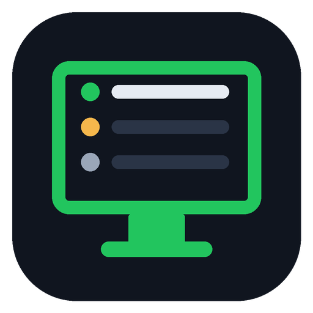
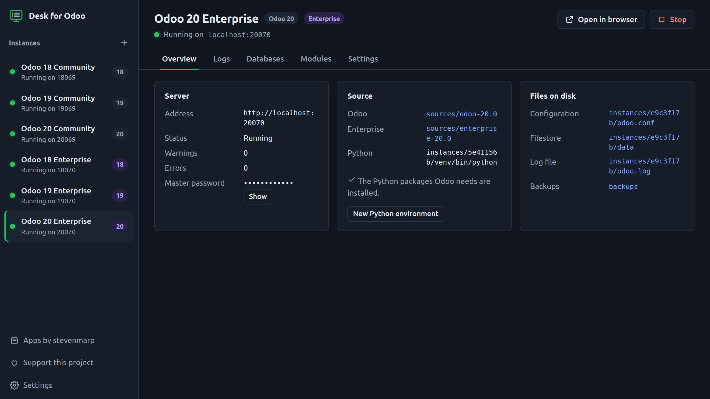
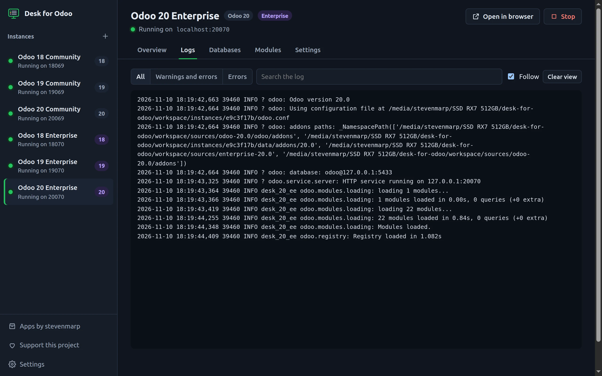
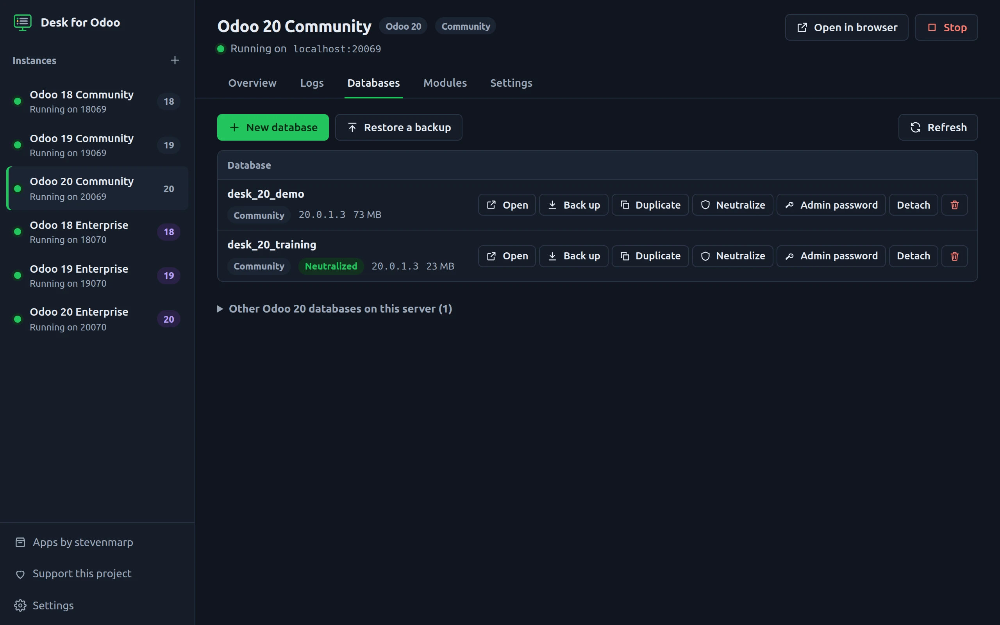
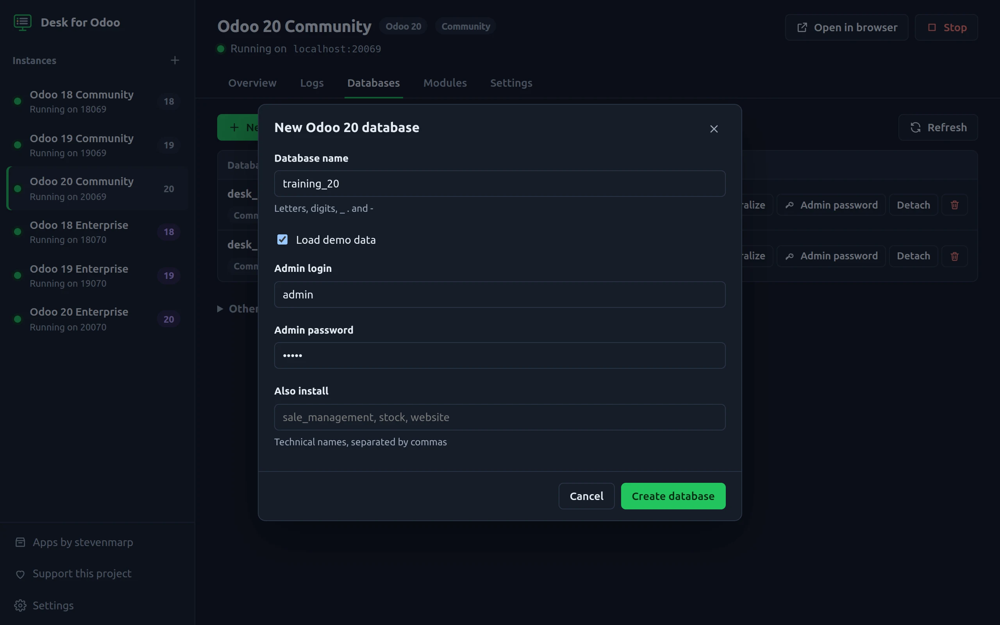
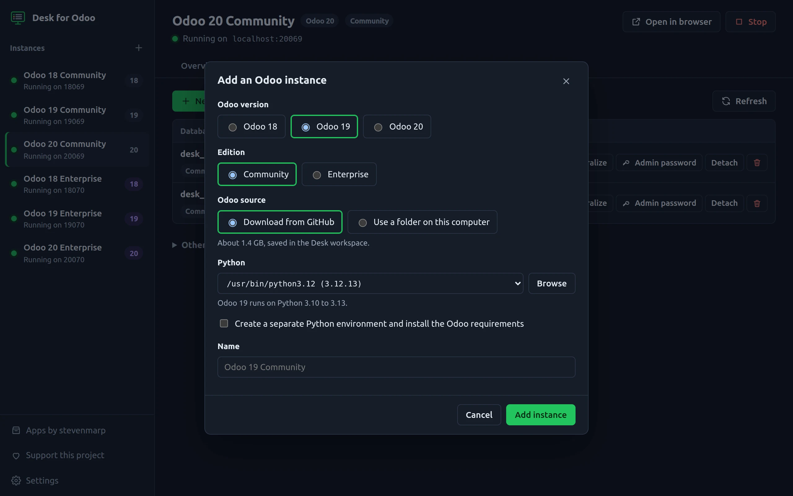
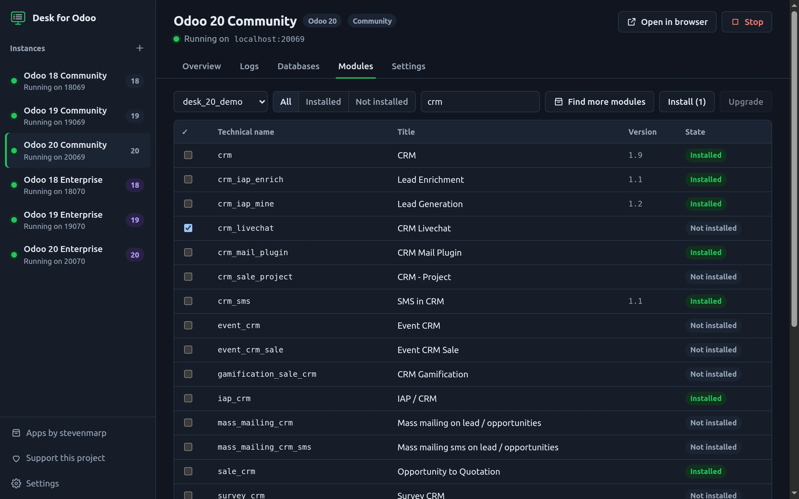
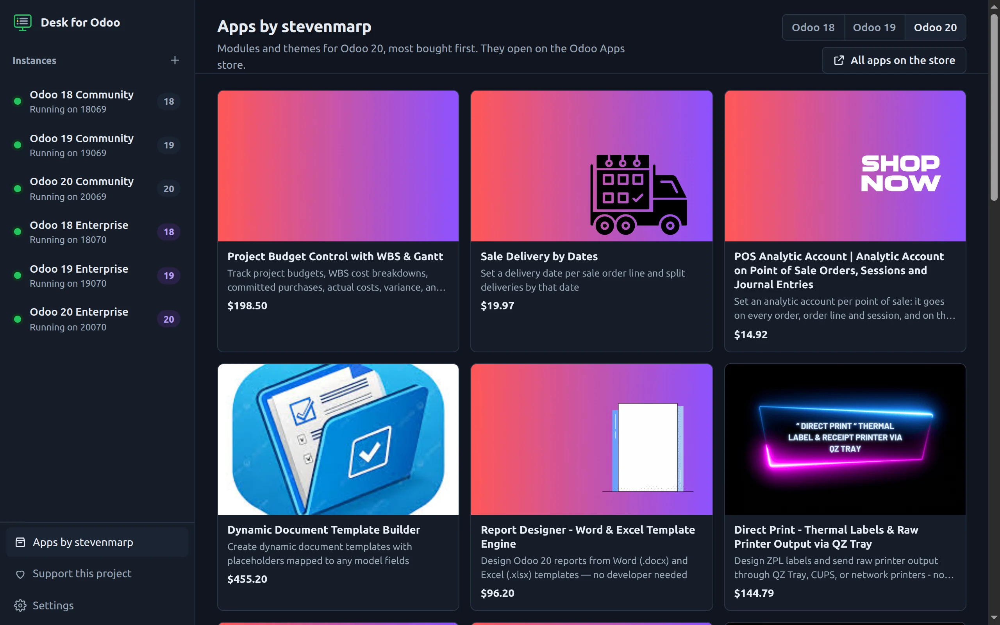

<div align="center">



# Desk for Odoo

**Odoo 18, 19 and 20 on your own computer, in one window.**
Community or Enterprise, side by side: start the servers, read the logs, manage the databases and install modules without a terminal.

[](LICENSE)


[Website](https://stevenmarp.github.io/desk-for-odoo/) · [Download](#download) · [What it does](#what-it-does) · [Screens](#screens) · [FAQ](#faq) · [Support](#support)



</div>

## Why

Running Odoo locally means the right Python for each version, PostgreSQL, a 1.4 GB clone, a
`requirements.txt` that fails to build on Windows, a config file per version, one terminal per server,
and `pg_dump` plus a filestore copy every time you need a backup. Desk for Odoo does all of it from one window.

| You want to | By hand | With Desk for Odoo |
| --- | --- | --- |
| Run Odoo 19 for the first time | Install Python, PostgreSQL, clone, pip, write `odoo.conf`, run `odoo-bin` | **Add instance** → **Start** |
| Run 18, 19 and 20 at the same time | Separate venvs, ports and configs, three terminals | One click each, free ports picked for you |
| Find why the server fails | Scroll a terminal | Live log, warnings and errors counted and highlighted, search |
| Back up a database | `pg_dump` and copy the filestore | **Back up**: one zip in the format Odoo's own manager restores |
| Play safely with a copy of production | Restore, then switch off mail servers, crons and payments | **Restore** or **Duplicate** with **Neutralize** ticked |
| Install or upgrade modules | Stop the server, `-i`/`-u`, start again | Tick the modules, **Install** or **Upgrade** |
| Forgot the admin password | `odoo-bin shell` and a script | **Admin password** |

Made for Odoo developers, functional consultants preparing demos, partners testing Enterprise,
trainers and students.

## What it does

- **Instances.** Odoo 18, 19 and 20, Community or Enterprise. Download Community from GitHub or use a folder
  you already have. Enterprise comes from your own copy, or from `github.com/odoo/enterprise` if your account
  has access (Odoo partners): the token is used for that download only and never saved.
- **Python.** Desk lists the Pythons on your computer that fit the version (18: 3.10 to 3.12, 19: 3.10 to 3.13,
  20: 3.12 to 3.14) and can make a separate environment with the Odoo requirements. Packages that often fail to
  build from source (`gevent`, `greenlet`, `psycopg2`) are taken as ready-made wheels instead.
- **Server.** Start and stop, a free port per instance, scheduled actions off unless you want them, the live log with warnings and errors counted on the tab,
  level filters, search, and the log file on disk.
- **Databases.** The databases of the instance with their edition and size; other databases of the same version on
  your server stay untouched until you attach one. Create
  (demo data, admin login and password, extra modules), back up, restore, duplicate, neutralize, set the admin
  password, delete (you type the name to confirm). All of it runs Odoo's own commands (`odoo-bin db`,
  `neutralize`, `shell`), so the filestore is always handled.
- **Modules.** Every module of your addons folders with its state in the chosen database. Install or upgrade
  several at once; the server is stopped and started again around it.
- **Your extra addons.** Add your own folders per instance, they come before Odoo's.
- **One workspace.** Sources, Python environments, configurations, filestores, logs and backups live in one
  folder you can open from the app.

## Screens

| Live log | Databases |
| --- | --- |
|  |  |
| **New database** | **Add an instance** |
|  |  |
| **Modules** | **Apps by stevenmarp** |
|  |  |

## Download

Get the installer for your system from the [latest release](https://github.com/stevenmarp/desk-for-odoo/releases/latest):

| System | File |
| --- | --- |
| Windows 10 and 11 | `Desk-for-Odoo-Setup-<version>.exe` |
| macOS | `Desk-for-Odoo-<version>.dmg` |
| Linux | `Desk-for-Odoo-<version>.AppImage` (`chmod +x`, then run it) |

The builds are not signed yet: Windows shows "Windows protected your PC" (**More info** → **Run anyway**) and
macOS asks you to open it from **System Settings → Privacy & Security** the first time.

You also need, once:

- **PostgreSQL** ([download](https://www.postgresql.org/download/)) with a user that can create databases:
  12 or later for Odoo 18, 13 for Odoo 19, 16 for Odoo 20. Desk asks for the host, user and password under **Settings**; the password is stored encrypted with
  your system keychain.
- **Python** in the range of the Odoo version you want ([python.org](https://www.python.org/downloads/)).
- **git** to download the Odoo source ([git-scm.com](https://git-scm.com/downloads)).

## Run from source

```bash
git clone https://github.com/stevenmarp/desk-for-odoo.git
cd desk-for-odoo
npm install
npm start
```

`DESK_WORKSPACE=/path/to/folder npm start` keeps the workspace (and the app's own data) in that folder, for
example on an external drive. `npm run dist` builds the installer for the system you are on.

## Where your files go

```
workspace/
├── desk.json                  instances and settings
├── sources/                   odoo-18.0, odoo-19.0, enterprise-19.0, ...
├── instances/<id>/
│   ├── odoo.conf              written before every start
│   ├── data/                  filestore and sessions
│   ├── odoo.log               the server log
│   └── venv/                  Python environment, if Desk made one
└── backups/                   <database>-<date>.zip
```

The workspace is in your user data folder unless you set `DESK_WORKSPACE`. Removing an instance from Desk
keeps its files and databases.

## Roadmap

Desk for Odoo stays free and open source. Next up: Odoo 17 and 16, a bundled PostgreSQL for Windows and macOS,
`git pull` for sources, a database template gallery, and running the test suite of a module.

A paid **Pro** edition is planned for teams: deploy an instance to your own server, share instances and settings
across a team, and demo-ready database templates. The free edition keeps everything listed above.

## FAQ

**Is this made by Odoo S.A.?** No. Desk for Odoo is an independent project. Odoo is a trademark of Odoo S.A.

**Do I need an Enterprise license?** Only for Enterprise. Desk never ships Enterprise code: you point it to a copy
you are allowed to use.

**Does it touch my existing databases?** No. An instance only runs on the databases it created, restored,
duplicated or that you attached yourself (`db_name` in its configuration), so a plain `odoo-bin` habit like running
every database on the server cannot happen. Scheduled actions are off by default and can be turned on per instance.
Delete always asks you to type the name.

**Can other computers on my network open these servers?** No. Every instance listens on `127.0.0.1` only, so a demo
database with `admin`/`admin` stays on your computer.

**What goes over the internet?** The Odoo source download from GitHub, the Python packages from PyPI, and the
list of apps in **Apps by stevenmarp**. Nothing else, no telemetry.

**Can I use my own addons?** Yes: add the folders in the instance settings.

## Support

Desk for Odoo is built and maintained by [Stevenmarp](https://github.com/stevenmarp). You can keep it going by:

- picking a module you need from **[Apps by stevenmarp](https://apps.odoo.com/apps/modules/browse?order=Newest&repo_maintainer_id=512936)** on the Odoo Apps store (also inside the app),
- a coffee on **[Saweria](https://saweria.co/Stevenmarp)**,
- a star on this repository and a bug report when something breaks.

## License

[MIT](LICENSE) © 2026 Stevenmarp
